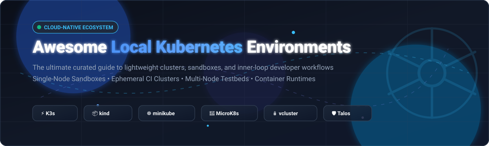

# ⚡ Awesome Local Kubernetes Environments ☸️

  

  
  
  
  
  

---

## 🌟 Top Local Kubernetes Environments & Developer Sandboxes Ecosystem

**Curated Directory of SaaS Products, Commercial Workstations & Open-Source GitHub Projects**  
*Focused on Single-Node Clusters, CI/CD Ephemeral Provisioning, Lightweight Virtual Clusters & Self-Hosted Development Sandboxes.*

**Last updated:** October 2026 | **Maintained by:** [@ishandutta2007](https://github.com/ishandutta2007)

> **Welcome to the definitive, SEO-optimized guide for local Kubernetes environments!**  
> Whether you need to simulate multi-node clusters in local Docker containers, test microservices offline, establish lightning-fast CI/CD inner-loop development workflows, or replace resource-heavy cloud environments with self-hosted lightweight distros like **K3s**, **minikube**, **kind**, or **vcluster**, this curated list helps you choose the right tool for your engineering stack.

---

## 📑 Table of Contents

- [📊 Sector Overview & Market Dynamics](#-sector-overview--market-dynamics)
- [💼 SaaS/Hosted Platforms & Commercial Developer Environments](#-saashosted-platforms--commercial-developer-environments)
- [🐙 Open-Source GitHub Projects (Ranked by Stars)](#-open-source-github-projects-ranked-by-stars)
- [🛠️ Additional VM & Container Runtime Foundations](#️-additional-vm--container-runtime-foundations)
- [🤝 How to Contribute](#-how-to-contribute)
- [💖 Support & Sponsorship](#-support--sponsorship)
- [📈 Star History](#-star-history)
- [⚠️ Disclaimer](#️-disclaimer)

---

## 📊 Sector Overview & Market Dynamics

The global Kubernetes and container management market is estimated at **$2.6B to $3.1B in 2024–2025**, projected to surpass **$11B+ by 2030** (~21–24% CAGR). The ecosystem exhibits a **bifurcated market structure**: while the local developer tooling and inner-loop layer remains **highly fragmented** across dozens of specialized open-source runtimes and sandboxes, commercial production adoption and revenue are **highly concentrated** among hyperscalers (GKE, EKS, AKS) and enterprise platform vendors (Red Hat, SUSE) who use desktop and local tooling as freemium adoption funnels.

---

## 💼 SaaS/Hosted Platforms & Commercial Developer Environments

While local Kubernetes environments are inherently client-side, major platform vendors offer SaaS, commercial desktop distributions, and hosted hybrid developer environments backed by enterprise subscriptions.

| Product / Platform | Company / Backer | Company Scale (Revenue / Valuation) | Starting Pricing (Paid Tiers) | Free Tier Limits / Free Trial |
| :--- | :--- | :--- | :--- | :--- |
| **[Red Hat OpenShift Local](https://developers.redhat.com/products/openshift-local/overview)** | Red Hat (IBM subsidiary) | **$7.33B ARR** (Red Hat unit) / **~$34B acquisition** (IBM parent ~$200B+ market cap) | **Free local binary**; Production OpenShift starting at **~$10,000 to $13,000/socket pair/year** | **Free forever** for local dev testing; Full OpenShift features a **30-day free trial** on hybrid cloud |
| **[SUSE Rancher Prime](https://www.rancher.com/)** | SUSE (EQT) | **~$800M Revenue** / **$2.9B–$4.5B Valuation** | Entry cloud marketplace packages starting at **$168/month** (up to 24 vCPUs); Enterprise bundles starting at **~$7,500/year** | Core Rancher open-source is **free forever** (no node cap); Managed cloud / Developer Access features a **30-day free trial** |
| **[Canonical Ubuntu Pro / MicroK8s Support](https://canonical.com/microk8s)** | Canonical Ltd. | **~$340M Revenue** / **~$1.5B–$2.0B Valuation** | **$25/workstation/year** (Desktop Pro); Servers from **$225/server/year** | **Free forever for personal use on up to 5 machines** (up to 50 machines for official Ubuntu community members) |
| **[Docker Desktop](https://www.docker.com/products/docker-desktop/)** | Docker, Inc. | **~$207M ARR** / **$2.1B Valuation** | Pro tier starting at **$9/user/month** (billed annually, $108/yr) or **$11/user/month** (monthly); Team at **$15/user/month** | **Free forever (Docker Personal)** strictly limited to personal use, education, open-source, or businesses with **<250 employees AND <$10M annual revenue** |

---

## 🐙 Open-Source GitHub Projects (Ranked by Stars)

Every major active open-source project for running Kubernetes locally, provisioning disposable CI sandboxes, and orchestrating container workloads on developer machines—sorted descending by GitHub community popularity.

---

### 1. **[K3s](https://github.com/k3s-io/k3s)**  ⚡
- **Focus**: The lightweight, CNCF-certified binary for edge, IoT, and resource-constrained workstations.
- **Architecture**: Single binary packaging under 50 MB with embedded SQLite/etcd, Traefik ingress, Flannel CNI, and Helm controller.
- **Footprint**: **512 MB minimum RAM**—the leanest full-featured distribution in production use.
- **Strengths**: Minimal memory footprint, production-identical APIs, zero external dependencies, rapid systemd/container startup.
- **Trade-offs**: Advanced multi-tier networking and storage plugins require manual configuration.

---

### 2. **[minikube](https://github.com/kubernetes/minikube)**  ☸️
- **Focus**: The official Kubernetes learning sandbox and addon-rich local cluster tool.
- **Architecture**: Runs single-node clusters inside macOS/Linux/Windows hypervisors (Hyper-V, VirtualBox, QEMU, KVM) or container engines (Docker, Podman).
- **Footprint**: Recommended 2 GB+ RAM and 2 vCPUs.
- **Strengths**: Turnkey one-command addons (`minikube addons enable ingress`, metrics-server, dashboard), multi-profile testing, direct local image injection via `minikube image load`.
- **Trade-offs**: Limited multi-node HA simulation; higher resource overhead than pure container-in-container solutions.

---

### 3. **[Colima](https://github.com/abiosoft/colima)**  🐧
- **Focus**: Minimal, blazing-fast container runtimes and Kubernetes on macOS and Linux with zero bloat.
- **Architecture**: Leverages Lima Linux virtual machines with automatic bidirectional file sharing, port forwarding, and native Docker/containerd CLI endpoints.
- **Footprint**: Highly configurable VM limits (defaults to 2 cores, 2 GB RAM).
- **Strengths**: Full replacement for commercial container runtimes; built-in one-flag Kubernetes support (`colima start --kubernetes`), seamless Docker CLI drop-in compatibility.
- **Trade-offs**: CLI-first configuration without a default desktop GUI; requires comfortable command-line familiarity.

---

### 4. **[kind (Kubernetes IN Docker)](https://github.com/kubernetes-sigs/kind)**  📦
- **Focus**: The CI/CD industry standard for ephemeral, reproducible multi-node Kubernetes clusters.
- **Architecture**: Runs each Kubernetes cluster node as an independent Docker container, booting multi-node topologies in under 30 seconds.
- **Footprint**: Extremely low idle footprint; scales linearly with container count.
- **Strengths**: Deterministic cluster versions through pinned container images (`kindest/node`), multi-node control planes, rock-solid stability in GitHub Actions/GitLab CI.
- **Trade-offs**: Requires Docker or containerd host engine; LoadBalancer services need `cloud-provider-kind` or MetalLB.

---

### 5. **[Talos Linux](https://github.com/siderolabs/talos)**  🛡️
- **Focus**: A modern, secure, and minimal OS designed specifically for Kubernetes.
- **Architecture**: Completely immutable and ephemeral Linux distribution without SSH or shell access; managed 100% via gRPC API (`talosctl`).
- **Footprint**: Under 100 MB kernel/initramfs image, sub-second boot times.
- **Strengths**: Pristine security posture, zero configuration drift, supports local multi-node clusters in Docker or QEMU with production parity.
- **Trade-offs**: Radical departure from standard Linux administration (no SSH or package manager).

---

### 6. **[vcluster](https://github.com/loft-sh/vcluster)**  🪆
- **Focus**: Virtual Kubernetes clusters running inside namespaces of an existing underlying cluster.
- **Architecture**: Spins up a fully virtualized, isolated control plane (API server, controller manager, storage) inside a regular pod, sharing underlying worker node capacity.
- **Footprint**: Virtually zero overhead beyond the light API server process.
- **Strengths**: Creates isolated tenant sandboxes in seconds without hypervisors; full admin access with custom CRDs inside tenant clusters; reduces cloud costs by up to 70%.
- **Trade-offs**: Dependent on an underlying Kubernetes host cluster (e.g., layered over kind, k3s, or cloud K8s).

---

### 7. **[MicroK8s](https://github.com/canonical/microk8s)**  🚀
- **Focus**: Canonical's zero-ops, snap-packaged Kubernetes cluster with native clustering and HA.
- **Architecture**: Self-contained binaries managed via Snap on Linux (or automated VMs on macOS/Windows), featuring integrated Dqlite HA datastore.
- **Footprint**: ~200 MB binary footprint; recommended 4 GB RAM for full desktop workstation workloads.
- **Strengths**: Built-in addons (`microk8s enable ingress storage dns dashboard gpu`), seamless node clustering, automated rolling security updates.
- **Trade-offs**: Linux snap packaging model may feel unfamiliar on non-Ubuntu distributions; heavier than K3s.

---

### 8. **[Podman Desktop](https://github.com/containers/podman-desktop)**  🦭
- **Focus**: Daemonless, open-source desktop container and Kubernetes environment GUI.
- **Architecture**: Open-source desktop UI orchestrating rootless Podman containers, local Kind/K3s clusters, and Kubernetes resources.
- **Footprint**: Lightweight GUI shell with configurable backing Linux virtual machine.
- **Strengths**: Completely free and open-source under Apache 2.0; rootless security model; direct Kubernetes YAML play and pod-to-kube manifest generators.
- **Trade-offs**: Extension ecosystem and Kubernetes debugging tooling still evolving compared to dedicated dev tools.

---

### 9. **[Rancher Desktop](https://github.com/rancher-sandbox/rancher-desktop)**  🤠
- **Focus**: Full-featured cross-platform Kubernetes and container management desktop application.
- **Architecture**: Bundles K3s alongside containerd or Moby (Docker API) in an automated, managed virtual machine on macOS, Windows, and Linux.
- **Footprint**: ~3 GB RAM recommended.
- **Strengths**: Switch Kubernetes versions with one click; select preferred container runtime; built-in image building, port forwarding, and GUI dashboard.
- **Trade-offs**: Requires factory reset or VM rebuild during certain low-level virtualization kernel updates.

---

### 10. **[k3d](https://github.com/k3d-io/k3d)**  🐳
- **Focus**: Fast, containerized K3s wrapper specifically engineered for multi-node local development and CI testing.
- **Architecture**: Runs lightweight K3s nodes as Docker containers, mirroring Kind's architecture with K3s's minimal runtime efficiency.
- **Footprint**: ~200 MB RAM per node.
- **Strengths**: Ultra-fast spin-up and teardown; multi-node cluster testing; hot-reloading code with volume mounts; perfect for GitHub Actions pipelines.
- **Trade-offs**: Requires host Docker runtime.

---

### 11. **[k0s](https://github.com/k0sproject/k0s)**  🎯
- **Focus**: Zero-friction, zero-dependencies single binary Kubernetes distribution by Mirantis.
- **Architecture**: Completely frictionless single-binary architecture with all dependencies packaged internally; supports multiple storage backends including SQLite and etcd.
- **Footprint**: ~160 MB binary, under 500 MB memory footprint.
- **Strengths**: Zero host OS prerequisites; automated worker join commands; pure upstream Kubernetes compliance with reduced attack surface.
- **Trade-offs**: Smaller community ecosystem compared to K3s and Minikube.

---

## 🛠️ Additional VM & Container Runtime Foundations

These open-source tools provide the foundational virtualization and container runtime layer beneath local Kubernetes installations:

- **[Lima (Linux on Mac)](https://github.com/lima-vm/lima)**  — Automatic Linux VMs with containerd/Docker and file forwarding.
- **[nerdctl](https://github.com/containerd/nerdctl)**  — Docker-compatible CLI for containerd supporting rootless containers, lazy pulling, and Kubernetes encryption.
- **[Multipass](https://github.com/canonical/multipass)**  — Canonical's lightweight Ubuntu VM orchestrator across macOS, Windows, and Linux.

---

## 🤝 How to Contribute

Contributions are warmly welcomed! Help expand and maintain this developer guide:

1. 🍴 **Fork** this repository.
2. 🌿 Create a descriptive branch: `git checkout -b feature/add-new-k8s-tool`.
3. 📝 Add or update entries in `README.md` following the existing format with accurate links and descriptions.
4. ⭐ Add appropriate shields and Stars_Badges.
5. 🚀 Submit a **Pull Request** with a concise summary of changes!

---

## 💖 Support & Sponsorship

If you find this curated ecosystem list helpful for your local development workflow, CI pipelines, or cloud-native learning, please consider supporting the project:

- ⭐ **Star this repository** to help other engineers discover it.
- 🍴 **Fork and share** it with your developer community and teams.
- ☕ **Buy a coffee / Sponsor**: Support ongoing maintenance, updates, and open-source research directly via the [GitHub Sponsors Dashboard](https://github.com/sponsors/ishandutta2007).

---

## 📈 Star History

---

## ⚠️ Disclaimer

- This is an independent, **community-curated** list — inclusion does not imply official endorsement.
- **Local fidelity vs. production parity**: Tools like kind and k3d default to local hostPath storage and require addons like MetalLB for LoadBalancer IPs; validate manifests against cloud staging before production deployments.
- **Hardware resource allocation**: Memory requirements range from ~512 MB for K3s up to 4 GB+ for full-fledged developer desktop VMs; allocate system resources accordingly.

---

  <b>Built with ❤️ for DevOps engineers, software architects, and Kubernetes developers.</b>

